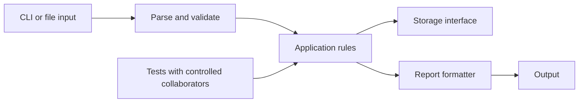

# Guided Python projects

[Course home](README.md) · [Learning path](LEARNING_PATH.md)

These are project specifications and small starter steps. Implement each in your
own practice environment; this course contains Markdown instructions only. Complete
one feature at a time. A feature is complete when you can explain its behavior and
check a normal case, a boundary case, and a failure case where relevant.

## 1. Score summary — beginner

**Prerequisites:** chapters 1–10, with conditions before loops.

Accept a collection of whole-number scores between 0 and 100. Report the count,
minimum, maximum, average, and how many scores pass a chosen threshold.

1. Write a function taking already validated numbers.
2. Define the empty-input result instead of dividing by zero.
3. Add a separate function that parses text scores and rejects invalid values.
4. Format a report without mixing printing into the calculation function.

Example acceptance cases:

| Input | Required behavior |
| --- | --- |
| `[40, 60, 80]`, pass mark 50 | Count 3; minimum 40; maximum 80; average 60; passed 2 |
| `[]` | A documented empty result, with no division by zero |
| `[-1]` or `[101]` | Reject the out-of-range value |
| Text `"hello"` | Explain that a score must be a whole number |

Small calculation step:

```python
def pass_count(scores, threshold=50):
    return sum(score >= threshold for score in scores)

print(pass_count([40, 60, 80]))
```

Output:

```text
2
```

**Extension:** group results by student name. Decide how duplicate names are handled.

## 2. Task list — beginner to intermediate

**Prerequisites:** modules, exceptions, files, classes, and CLI basics.

Support adding a task, listing tasks, and marking one complete. Store records as
dictionaries or dataclasses with a stable identifier, title, and completion flag.

1. Implement the operations entirely in memory.
2. Give every task an identifier independent of its list position.
3. Add JSON loading and saving at the application boundary.
4. Add a command-line interface calling the same tested operations.

Acceptance cases: a new task starts incomplete; completing it twice has a documented
policy; an unknown identifier produces a clear failure; an empty list displays
sensibly; malformed saved JSON is reported rather than silently overwritten.

```python
tasks = [{"id": 1, "title": "Read about functions", "done": False}]
task = next(task for task in tasks if task["id"] == 1)
task["done"] = True
print(task["title"], task["done"])
```

Output:

```text
Read about functions True
```

**Extension:** distinguish validation failures from file errors. Consider writing
a replacement file and renaming it when reliable persistence matters; document
what guarantees your chosen filesystem approach provides.

## 3. Expense summary — intermediate

**Prerequisites:** standard library, CSV, Decimal, dates, and testing.

Read rows with date, category, and amount. Validate each row and produce totals by
category. Treat amounts as decimal strings and choose a rounding policy.

1. Start with a list of dictionaries instead of file I/O.
2. Parse dates and amounts; reject missing or malformed fields.
3. Aggregate values by category using a normal dictionary or defaultdict.
4. Add CSV input and report invalid rows with their row numbers.

Acceptance cases: repeated categories combine; an empty file gives no totals; a
quoted comma inside a CSV field parses correctly; an impossible date is rejected;
negative amounts follow a documented refund policy; binary float is not introduced
before Decimal conversion.

```python
from decimal import Decimal
amounts = [Decimal("1.10"), Decimal("2.20")]
print(sum(amounts, start=Decimal("0.00")))
```

Output:

```text
3.30
```

**Extension:** report monthly totals using timezone-aware timestamps only when the
source actually includes times. Do not invent timezone information for date-only records.

## 4. Contact database — intermediate

**Prerequisites:** SQLite, exceptions, type hints, testing, and CLI basics.

Create, search, update, and delete contacts. Use a primary key and a documented
uniqueness rule. Keep database access behind functions with clear inputs and results.

1. Start with an in-memory database in tests.
2. Bind all data values as parameters.
3. Define transactions around operations that must succeed together.
4. Add persistent storage and a simple interface after the core operations work.

Acceptance cases: apostrophes in names work; missing contacts return a documented
absence or error; duplicates follow the uniqueness policy; a failed multi-step
update rolls back; connections close even after a failure; ordered reports use ORDER BY.

```python
name = "O'Neil"
query = "SELECT id FROM contacts WHERE name = ?"
parameters = (name,)
print(query)
print(parameters[0])
```

Output:

```text
SELECT id FROM contacts WHERE name = ?
O'Neil
```

**Extension:** add a schema version and a small migration. An ORM is optional;
explain the SQL and transaction behavior before adding one.

## 5. Bounded job runner — advanced

**Prerequisites:** coroutines, tasks, cancellation, context managers, and testing.

Process local simulated jobs concurrently. Use `await asyncio.sleep(0)` to model a
cooperative pause. Begin with fixed inputs rather than a real network.

1. Write one coroutine that produces a result for one job.
2. Run several jobs and preserve a documented result order.
3. Limit active work. For large input streams, use a bounded queue and a fixed
   number of workers instead of creating one task per input.
4. Choose whether one failure cancels the group or becomes a per-job result.
5. Propagate caller cancellation after cleanup.

Acceptance cases: no jobs completes cleanly; each successful job has one result;
an individual failure follows policy; concurrency stays under the limit; cancelled
work does not keep running unnoticed; no test depends on exact elapsed milliseconds.

**Extension:** adapt a blocking operation through a thread and explain why this
does not automatically speed up CPU-heavy Python calculations.

## 6. Capstone: searchable report tool

Combine a CLI, validated configuration, a data parser, a calculation layer,
storage, and a report formatter. Choose a small domain such as books, expenses,
or completed tasks. Keep the first version local and deterministic.



Your final review should demonstrate:

- A clear function or class contract for each responsibility.
- Tests for ordinary, boundary, and invalid inputs.
- Explicit resource lifetime, transaction boundaries, and error handling.
- Type hints that describe contracts without pretending to validate external data.
- A documented dependency environment and a repeatable way to run the program.
- One measured performance question, with an explanation of whether optimization helped.

Add a web framework only after these interfaces work independently. The course is
general-purpose Python, so no framework is required for completion.
