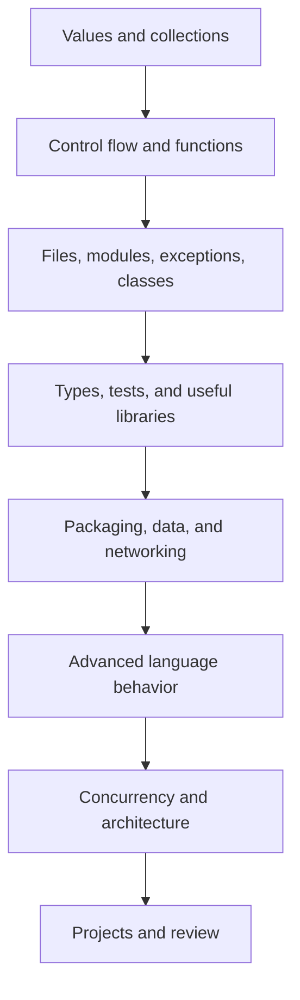

# Python: beginner to advanced

A complete study path through Python fundamentals, practical programming, and advanced
language behavior. The course has **26 main chapters and 27 advanced lessons**, with
explanations, small examples, expected outputs, flow diagrams, and practice answers.

Start with the [learning path](LEARNING_PATH.md). Use the
[guided projects](PRACTICE_PROJECTS.md) to combine ideas, and the
[review questions](REVIEW_QUESTIONS.md) to check your understanding.

## How to study

1. Read the explanation and predict each example's output.
2. Run one fenced Python block at a time in your own Python environment.
3. Change a value and explain the new behavior.
4. Solve the practice before opening the worked answer.
5. Complete the stage's project and checkpoint before moving on.

Examples are independent unless explicitly described as a continuation. Most contain
only a few lines; longer ideas are split into focused examples. The expanded course
is in Markdown. Existing `index.py` and `examples.py` files demonstrate the original
introductory snippets, not all the expanded material.

The core examples use **Python 3.10+** syntax. The TaskGroup extension is labelled
**Python 3.11+**. Examples use the standard library; optional packaging commands are
separate setup instructions. Run async blocks from a script environment, or use
`await main()` in a notebook with an active event loop instead of nesting `asyncio.run`.

Diagrams use Mermaid. View these files with a Mermaid-capable Markdown preview.
Arrows show progression; labelled branches show choices. Plain-text source remains
available in any editor.

## Main chapters

Study **8 (conditions) before 7 (loops)**. The original folder numbers are preserved.
Read the advanced async lessons before chapter 25.

| Chapter | Focus |
| --- | --- |
| [1. Introduction to Python](1.introduction/README.md) | Run Python, expressions, statements, indentation, comments |
| [2. Variables](2.variables/README.md) | Names, assignment, unpacking, mutation versus rebinding |
| [3. Data Types](3.datatypes/README.md) | Built-in types, bytes, numeric precision |
| [4. Type Conversion](4.type-casting/README.md) | Explicit conversion and invalid input |
| [5. Data Structures](5.data-structure/README.md) | Lists, tuples, dictionaries, sets, sorting, nested values |
| [6. Equality and Comparisons](6.equality-comparisons/README.md) | Equality, identity, ordering, missing versus false values |
| [7. Loops and Iteration](7.loops-and-iterations/README.md) | Iteration, range, enumerate, zip, break, continue, loop else |
| [8. Operators and conditions](8.operators-and-conditions/README.md) | Operators, truthiness, short circuiting, match |
| [9. Functions](9.functions/README.md) | Contracts, parameters, defaults, closures as a next step |
| [10. Strings and comprehensions](10.strings-and-comprehensions/README.md) | Text transformations, slicing, formatting, collections |
| [11. Modules and packages](11.modules-and-packages/README.md) | Imports, names, package context, virtual environments |
| [12. Errors and exceptions](12.errors-and-exceptions/README.md) | Validation, recovery, exception propagation, cleanup |
| [13. File handling](13.file-handling/README.md) | Text and binary I/O, stream position, CSV |
| [14. Classes and objects](14.classes-and-objects/README.md) | Instance state, methods, alternative constructors |
| [15. Input, output, and command-line programs](15.input-output-and-cli/README.md) | Input parsing, output, command-line arguments |
| [16. Type hints and contracts](16.type-hints/README.md) | Annotations, unions, TypedDict, type variables |
| [17. Useful standard-library tools](17.standard-library-tools/README.md) | Counter, defaultdict, deque, dates, Decimal, itertools |
| [18. Regular expressions](18.regular-expressions/README.md) | Searching, whole-input matching, captures, substitution |
| [19. Testing and debugging](19.testing-and-debugging/README.md) | Behavior checks, unittest, test doubles, debugging |
| [20. Logging and configuration](20.logging-and-configuration/README.md) | Log levels, settings, validation, dependency boundaries |
| [21. Environments, dependencies, and packaging](21.environments-and-packaging/README.md) | Interpreters, dependencies, project layout, distributions |
| [22. Databases and SQLite](22.databases-and-sqlite/README.md) | SQL parameters, queries, transactions, connection lifetime |
| [23. HTTP and networking fundamentals](23.http-and-networking/README.md) | URLs, requests, responses, parsing, transport boundaries |
| [24. Algorithms and complexity](24.algorithms-and-complexity/README.md) | Time and space, lookup choices, binary search |
| [25. Concurrency and parallelism](25.concurrency-and-parallelism/README.md) | Threads, processes, queues, locks, bounded async work |
| [26. Program design and architecture](26.design-and-architecture/README.md) | Responsibility, composition, injection, protocols |

## Advanced lessons

The [advanced index](Advanced%20concepts/README.md) contains 27 expanded lessons:

- Scope, closures, mutation, and reference sharing.
- Higher-order functions, partial application, decorators, recursion, and caching.
- Inheritance, method resolution, properties, and dataclasses.
- Coroutines, tasks, task groups, cancellation, and async failures.
- Copying, JSON, iterators, generators, paths, and context managers.
- Memory behavior, lazy processing, module systems, and exception design.
- Special methods, descriptors, attribute access, bytecode, and concurrency internals.

Each advanced lesson has its original flow diagram plus deeper explanations,
additional examples, and a practice question with an answer.

## Learning flow

## Practice and reference

- [Learning path and completion checkpoints](LEARNING_PATH.md)
- [Six guided projects, from score summaries to a capstone](PRACTICE_PROJECTS.md)
- [Review questions with explanations](REVIEW_QUESTIONS.md)
- [JavaScript to Python comparison](javascript-to-python.md)

For deeper reference, use the [Python tutorial](https://docs.python.org/3/tutorial/),
[standard library](https://docs.python.org/3/library/),
[typing reference](https://docs.python.org/3/library/typing.html),
[asyncio tasks](https://docs.python.org/3/library/asyncio-task.html), and
[Python Packaging User Guide](https://packaging.python.org/en/latest/).
Those references may include features newer than the core course's baseline.
