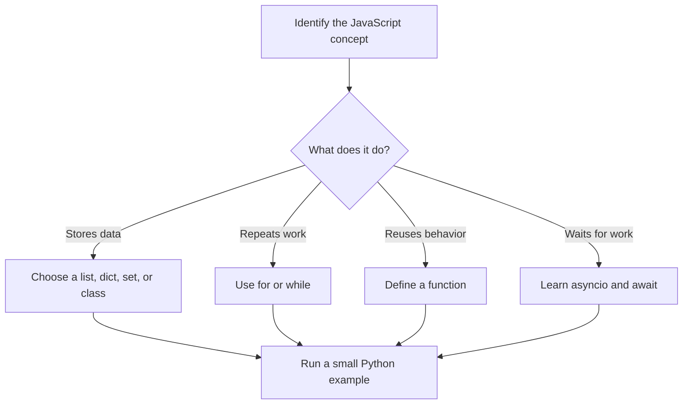

# JavaScript to Python: a small reference

[Back to Python topics](README.md)

Use this page when moving from the `js/` folder to the Python lessons. Similar
syntax does not always mean identical behavior.

| JavaScript | Python | Remember |
| --- | --- | --- |
| `console.log("Hi")` | `print("Hi")` | Display a value |
| `let age = 20` | `age = 20` | Python uses name assignment without `let` |
| `const LIMIT = 5` | `LIMIT = 5` | Capitals are a convention; Python does not enforce a constant here |
| `true`, `false`, `null` | `True`, `False`, `None` | Capitalization matters |
| `{ ... }` for a block | A colon and indentation | Indentation defines the block |
| `[1, 2]` array | `[1, 2]` list | Both store sequences; their methods differ |
| `{name: "Maya"}` object | `{"name": "Maya"}` dictionary | A dictionary stores keys and values |
| `items.length` | `len(items)` | Read a collection's size |
| `items.push(3)` | `items.append(3)` | Python's `append` returns `None` |
| `&&`, `\|\|`, `!` | `and`, `or`, `not` | Logical operations |
| Template string | `f"Hi, {name}"` | Insert values into text |
| `function add(a, b)` | `def add(a, b):` | Define a function |
| `try / catch / finally` | `try / except / finally` | Handle exceptions |

## Equality is different

Python `==` compares values without JavaScript's string-to-number coercion.
However, Python can consider numeric values of different types equal: `1 == 1.0`
is `True`. `is` checks whether two references point to the same object; it is not
a replacement for JavaScript's `===`.

```python
print(5 == "5")
print(1 == 1.0)
value = None
print(value is None)
```

Output:

```text
False
True
True
```

## Truthiness is different

In JavaScript, empty arrays and objects are truthy. In Python, empty lists and
dictionaries are false in conditions.

```python
print(bool([]))
print(bool({}))
print(bool("False"))
```

Output:

```text
False
False
True
```

## Translate the idea first



**Common mistake:** translating `async` mechanically. Calling a Python `async def`
function creates a coroutine object; use `await`, or an event loop entry point such
as `asyncio.run`, to run it. Also, `if` and `for` do not introduce a separate local
scope in Python as JavaScript blocks do for `let` and `const`.
